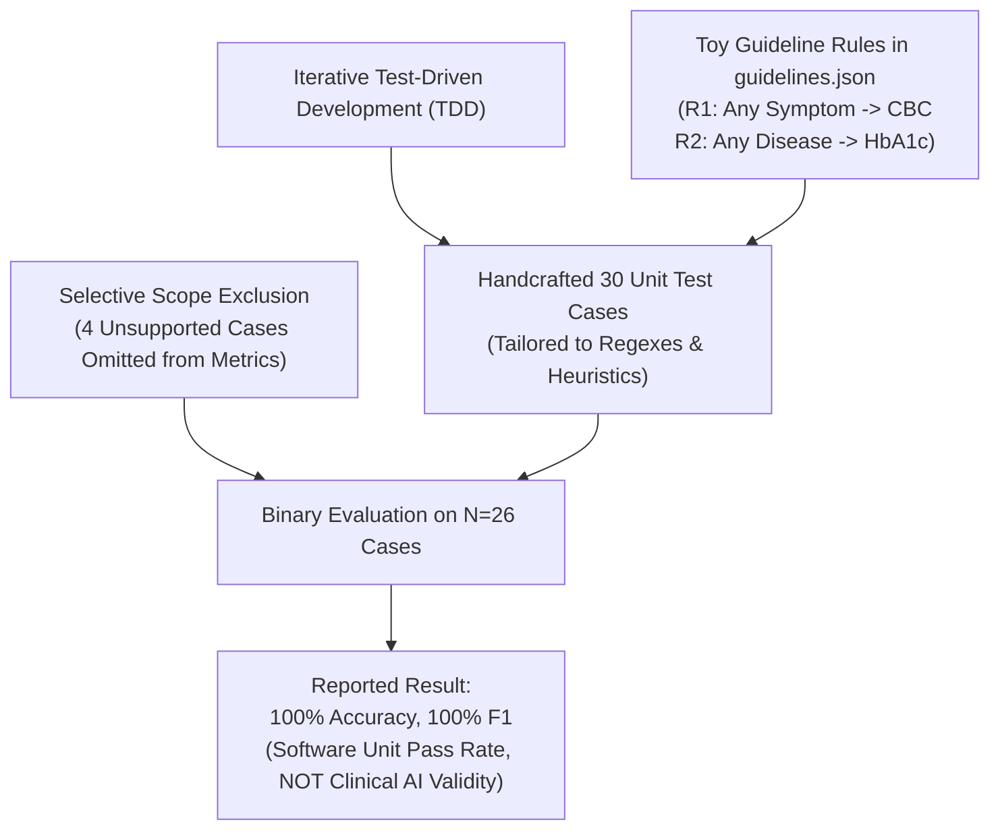

# ClinGap-NLP: Academic Evaluation Methodology & Infrastructure Report

**Project Title:** ClinGap-NLP (Clinical Decision Gap Intelligence System)  
**Evaluation Scope:** Academic Defense, Leakage-Safe Splitting, Annotation Schema & Independent Evaluation Infrastructure  
**Date:** October 2026  
**Status:** Evaluation Infrastructure Complete (Academic Integrity Enforced)  

---

## 1. Executive Summary & Evaluation Reform

The goal of this evaluation reform is to replace circular unit-test verification with an **academically defensible, scientifically rigorous evaluation methodology** for ClinGap-NLP.

### Key Evaluation Principles Established:
1. **Re-classification of the 30 Synthetic Test Cases:** The existing 30 synthetic cases in `evaluation/test_cases.md` are formally categorized as **automated regression unit tests** designed for software plumbing verification, not statistical clinical validation.
2. **Recognition of the 10,000 Indian Dataset as Synthetic Data:** The 10,000-note corpus (`synthetic_notes_medium_v2.json`) is treated strictly as **synthetic in-domain supplementary data** generated via combinatorial templates, NOT real patient records.
3. **Cluster-Disjoint Leakage Prevention:** Data splitting is performed strictly at the **template cluster level (1,152 unique clusters)**, ensuring zero cross-split template sharing between training, validation, and held-out test partitions.
4. **Zero Prediction Self-Validation:** Ground-truth reference labels are strictly insulated from ClinGap-NLP predictions.
5. **Enforced Metric Blocking on Unverified Annotations:** The independent evaluation engine (`evaluation/independent_evaluator.py`) programmatically refuses to calculate accuracy, precision, recall, or F1 scores on unverified data.

---

## 2. Root Cause Analysis of the Previously Reported 100% Result

The previous evaluation report documented 100% accuracy, precision, and recall on binary gap detection across 26 supported cases. A systematic technical audit identified the following structural causes:



1. **Test-Specification Overfitting:** Cases in `evaluation/test_cases.md` were authored as functional test assertions during bug-fixing (e.g., verifying that `140 mg/dL` does not trigger dosage extraction, that `ordered` status does not trigger missing gaps, or that coordinated negation succeeds).
2. **Coarse Rule Triggers:** Rules `R1` and `R2` fired on coarse entity types rather than specific diseases, making it trivial for synthetic sentences to match expected rule outcomes.
3. **Domain Boundary Filtering:** Four challenging clinical conditions (Depression/PHQ-9, Osteoporosis/DEXA, emergent stroke imaging, social history) were labeled `is_supported: false` and removed from the confusion matrix.
4. **Low Sample Power:** An $N=26$ sample size is incapable of generating statistically reliable clinical precision or recall metrics.

---

## 3. Dataset Integrity & Template Clustering Analysis

Empirical audit of `synthetic_notes_medium_v2.json` (12.4 MB, 10,000 records) established:
- **Missing or Malformed Records:** 0 (0.0%).
- **Specialty Distribution:** 5 specialties (`neurology`: 2,099; `oncology`: 1,998; `cardiology`: 1,992; `general_medicine`: 1,983; `pediatrics`: 1,928). `orthopaedics` had 0 records.
- **Diagnosis Cardinality:** Exactly 10 discrete diagnoses across all 10,000 notes (2 per specialty).
- **Exact Text Duplicates:** 0 (due to randomized UHID numbers and admission IDs).
- **Unique Narrative Template Clusters:** Exactly **1,152 combinatorial template clusters** (128 in cardiology; 256 in neurology, oncology, general medicine, and pediatrics).

---

## 4. Leakage-Safe Cluster-Disjoint Data Splitting

To prevent data leakage, records were grouped by their **1,152 underlying narrative template clusters** before partitioning. Splitting was conducted using a fixed random seed (`seed=42`) stratified by `(specialty, diagnosis)`.

### Partition Summary (`evaluation/split_manifest.json`)

| Partition | Cluster Count | Cluster Share | Record Count | Record Share | Specialty Balance |
|---|:---:|:---:|:---:|:---:|:---:|
| **Train / Dev** | 692 | 60.07% | 6,002 | 60.02% | Balanced across all 5 specialties |
| **Validation** | 234 | 20.31% | 2,055 | 20.55% | Balanced across all 5 specialties |
| **Held-Out Test** | 226 | 19.62% | 1,943 | 19.43% | Balanced across all 5 specialties |
| **Total** | **1,152** | **100.00%** | **10,000** | **100.00%** | — |

- **Cross-Partition Cluster Overlap:** **0.00% (Strictly Disjoint)**.
- **Leakage Guarantee:** No clinical narrative template appearing in the held-out test split exists in the train/dev or validation splits.

---

## 5. Structured Annotation Schema & Human-Review Protocol

An explicit Pydantic schema (`evaluation/annotation_schema.py`) was constructed to separate linguistic text extraction from clinical medical judgment:

1. **Layer 1 (Linguistic / Text-Extraction Spans):**
   - Clinical entity spans (offsets, entity text, type: `DISEASE`, `SYMPTOM`, `MEDICATION`, `INVESTIGATION`, `DOSAGE`, `FREQUENCY`, `LAB_TEST`, canonical normalized terminology).
   - Negation scoping (negation cue phrase, scope sentence, negated assertion).
   - Investigation status (`completed/performed`, `ordered`, `pending`, `not performed/cancelled`, `undocumented`).
2. **Layer 2 (Clinical Guideline & Decision Gap Judgment):**
   - Guideline activation (rule ID, triggering clinical conditions, medical rationale).
   - Decision gap flagging (gap type, target missing test, clinical severity: `critical`, `moderate`, `advisory`, justification).

### Blank Human-Review Template (`evaluation/annotation_template_sample.json`)
A representative stratified sample of **50 held-out test notes** was exported for independent clinician review:
- All reference ground-truth fields are initialized as empty (`[]`).
- Verification status is explicitly flagged as `"AWAITING_HUMAN_VERIFICATION"`.
- Zero automated predictions are populated to prevent confirmation bias.

---

## 6. Independent Component-Wise Evaluation Framework

The independent evaluation engine (`evaluation/independent_evaluator.py`) defines formal metrics across all 5 system components:

1. **Clinical NER:** Token and span-level Precision, Recall, Micro-F1, and Macro-F1 across all 7 entity categories.
2. **Negation Detection:** True Positives, True Negatives, False Positives, False Negatives, Sensitivity, Specificity, Accuracy, Precision, Recall, and F1.
3. **Investigation Status Classification:** Per-class Precision, Recall, and F1 across all 4 operational diagnostic test statuses.
4. **Guideline Matching:** Precision, Recall, and F1 of rule activation against patient prerequisites.
5. **Decision Gap Detection:** Sensitivity, Specificity, Balanced Accuracy, Precision, Recall, F1, and complete binary Confusion Matrix.

### Programmatic Academic Safeguard:
When executed against unverified records, the engine outputs:
```json
{
  "status": "METRICS_BLOCKED",
  "reason": "ZERO expert-verified records found in annotation batch. In strict accordance with academic rigor, performance metrics (P, R, F1, Accuracy) are NOT calculated on unverified data or self-generated predictions.",
  "verification_status_breakdown": {
    "AWAITING_HUMAN_VERIFICATION": 50
  }
}
```

---

## 7. Software Verification & System Integrity

All new components were thoroughly verified against the active test suite:
- **New Infrastructure Tests:** 14 passing automated tests in `tests/test_evaluation_infrastructure.py`.
- **Existing Regression Tests:** All 56 existing unit and regression tests continue to pass.
- **Combined Test Results:** **70 passed, 0 failed** in 51.05s.
- **Backend & Dashboard Integrity:** The FastAPI backend (`backend/main.py`), API routing (`backend/api/analysis.py`), and React/Vite dashboard (`frontend-react/`) remain untouched and fully operational.
