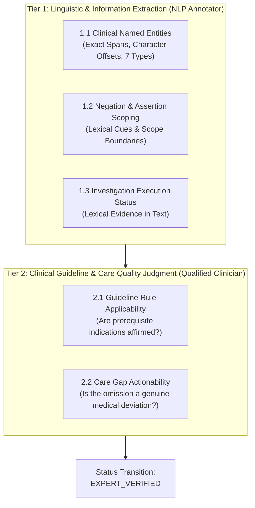

# ClinGap-NLP: Human Annotation Manual & Calibration Protocol

**Version:** 1.0 (Academic Protocol)  
**Target Datasets:** `held_out_test` partition (`annotation_template_sample.json`, `pilot_10_cases/`)  
**Status:** Reference Manual for Human Annotators & Domain Experts  

---

## 1. Two-Tier Annotation Model: Linguistic vs. Clinical Judgment

To maintain strict academic defensibility, ClinGap-NLP separates annotations into two distinct tiers:

- **Tier 1 (Linguistic Annotation):** Focuses strictly on *what is explicitly written in the note*. Can be completed by trained NLP annotators.
- **Tier 2 (Clinical Judgment):** Focuses on *whether the clinical management complies with standard care guidelines*. Must be performed or independently verified by a qualified medical professional.

---

## 2. Tier 1: Linguistic Extraction Instructions & Examples

### 2.1 Entity Boundaries & Entity Types

ClinGap-NLP recognizes 7 clinical entity types:

| Entity Type | Definition | Valid Examples | Invalid / Boundary Pitfalls |
|---|---|---|---|
| `DISEASE` | Formal medical diagnoses, chronic conditions, syndromes. | `"NSTEMI"`, `"Atrial Fibrillation"`, `"Community-Acquired Pneumonia"`, `"Hypertension"`, `"Migraine"` | ❌ Do NOT include ICD codes (e.g., tag `"NSTEMI"`, not `"NSTEMI (ICD: I21.4)"`). |
| `SYMPTOM` | Patient complaints, clinical signs, symptoms. | `"chest pain"`, `"saans phoolna"`, `"weakness"`, `"fever"`, `"headache"`, `"rash"` | ❌ Do NOT tag durations inside the symptom span (tag `"fever"`, not `"fever for 3 days"`). |
| `MEDICATION` | Pharmaceutical drug names (brand or generic). | `"Aspirin"`, `"Atorvastatin"`, `"Amoxicillin"`, `"Clopidogrel"`, `"Zinc"` | ❌ Do NOT include prefixes like `"Tab."` or `"Syrup"` in the medication span. Tag `"Aspirin"`, not `"Tab. Aspirin"`. |
| `INVESTIGATION` | Diagnostic tests, laboratory investigations, imaging, procedures. | `"ECG"`, `"Trop-I"`, `"Echo"`, `"Angiogram"`, `"CBC"`, `"MRI"`, `"CT"`, `"Endoscopy"`, `"Mammogram"` | ❌ Do NOT tag document section headings like `"Investigations:"` or `"Physical Examination:"` as investigations! |
| `DOSAGE` | Numerical drug strength and dosage quantity. | `"75mg"`, `"40mg"`, `"500mg"`, `"5ml"` | ❌ Do NOT tag blood pressure (`"120/80 mmHg"`) or glucose units (`"140 mg/dL"`) as dosages! |
| `FREQUENCY` | Dosing frequency / administration schedule. | `"OD"`, `"HS"`, `"TDS"`, `"twice daily"`, `"once daily"` | ❌ Do NOT include medication names in frequency span. |
| `LAB_TEST` | Specific lab measurements, test scores, or physical exam signs. | `"EF 47%"`, `"ST elevation"`, `"Positive"` (for Trop-I), `"WBC elevated"` | ❌ Do NOT tag administrative numbers (e.g. UHID `"632376936"`) as lab tests! |

---

### 2.2 Negation Cues & Scope Boundaries

Clinical negation indicates that a symptom or disease is explicitly denied or absent.

#### Common Negation Cues in Indian Clinical Summaries:
- **Pre-negation cues:** `"no"`, `"denies"`, `"denied"`, `"without"`, `"absence of"`.
- **Post-negation cues:** `"was not performed"`, `"not done"`, `"negative"`, `"absent"`, `"declined"`, `"cancelled"`.
- **PICCKLE physical exam signs:** In Indian notes, the physical exam often records:  
  `Pallor: +, Icterus: -, Cyanosis: -, Clubbing: -, Koilonychia: -, Lymphadenopathy: -, Edema: -`  
  Here, `-` signifies negation (`is_negated: True`), whereas `+` signifies presence (`is_negated: False`).

#### Annotation Examples:

1. **Sentence:** *"Irregular heartbeat, no syncope."*
   - Entity: `"syncope"` (`SYMPTOM`)
   - `is_negated`: `True`
   - `negation_cue`: `"no"`
   - `scope_text`: `"no syncope"`

2. **Sentence:** *"Patient has right knee pain. No history of chronic illness."*
   - Entity: `"chronic illness"` (`DISEASE`)
   - `is_negated`: `True`
   - `negation_cue`: `"No history of"`

3. **Sentence:** *"Physical Examination: Cyanosis: -, Clubbing: -"*
   - Entity: `"Cyanosis"` (`SYMPTOM`) $\rightarrow$ `is_negated: True`, cue: `"-"`
   - Entity: `"Clubbing"` (`SYMPTOM`) $\rightarrow$ `is_negated: True`, cue: `"-"`

4. **Sentence:** *"Chest pain aur saans phoolna for 5 days."*
   - Entity: `"Chest pain"` $\rightarrow$ `is_negated: False`
   - Entity: `"saans phoolna"` $\rightarrow$ `is_negated: False`

---

### 2.3 Investigation Clinical Status

Every diagnostic investigation mentioned must be classified into one of four operational statuses based on lexical evidence in the narrative:

| Status Value | Clinical Meaning | Textual Evidence Patterns | Example |
|---|---|---|---|
| `completed/performed` | Test was executed and findings/numerical results are documented. | `"showed"`, `"revealed"`, `"was performed"`, numerical results (e.g., `EF 50%`, `ST elevation`). | *"ECG: ST elevation; Trop-I: Positive."* $\rightarrow$ `completed/performed` |
| `ordered` | Test was requisitioned/sent, but results are not yet reported. | `"was ordered"`, `"has been sent"`, `"requisitioned"`, `"to be ordered"`. | *"CBC was ordered for evaluation."* $\rightarrow$ `ordered` |
| `pending` | Test is explicitly awaiting laboratory or imaging review. | `"results pending"`, `"awaited"`, `"result awaited"`, `"in progress"`. | *"Blood culture was sent, results pending."* $\rightarrow$ `pending` |
| `not performed/cancelled` | Test was explicitly omitted, declined, refused, or cancelled. | `"was not done"`, `"not performed"`, `"refused"`, `"cancelled"`, `"sample hemolyzed"`. | *"X-ray was not performed due to patient refusal."* $\rightarrow$ `not performed/cancelled` |
| `undocumented` | Test is NOT mentioned anywhere in the clinical text. | Absence of mention in text. | Used when auditing if a guideline-recommended test was omitted. |

---

## 3. Tier 2: Clinical Guideline & Decision Gap Judgments (Clinician Review)

### 3.1 Guideline Applicability

A guideline rule is **triggered** ONLY when the patient’s documented clinical presentation meets the clinical prerequisites:

- **Diabetes Glycemic Monitoring:** Triggered ONLY if the patient has confirmed or suspected Diabetes Mellitus (T1DM or T2DM).  
  *Negative Example:* Do NOT trigger a diabetes guideline for a patient presenting with an acute ischemic stroke or pneumonia who has no diabetic history.
- **Chest Pain / Acute Coronary Syndrome:** Triggered if patient presents with acute substernal chest pain or diaphoresis. Mandates ECG and cardiac biomarkers.
- **Respiratory Presentation / Pneumonia:** Triggered by fever, productive cough, and crepitations. Mandates imaging (Chest X-ray) and baseline inflammatory workup.

### 3.2 Decision Gap Flagging & Actionability

A decision gap occurs when a medically necessary action was **omitted without clinical justification**:

- **Actionable Gap (`is_actionable_gap: True`):**
  - Patient has confirmed Type 2 Diabetes on insulin, but no HbA1c or blood glucose monitoring is documented anywhere during the inpatient stay or discharge summary.
  - Patient presents with acute stroke symptoms, but emergent neuroimaging was not performed or documented.
- **Non-Gap / Satisfied Care (`is_actionable_gap: False`):**
  - The test was already completed (`completed/performed`).
  - The test was ordered and results are pending (`ordered` or `pending`). An active order satisfies the clinician's decision step.
  - The test was not indicated for this specific diagnosis.

---

## 4. Annotation Provenance & Quality Workflow

1. **Initial Review:** Annotator reads the clinical narrative in `pilot_10_cases.json` or `annotation_template_sample.json`.
2. **Tagging:** Fills in `entities`, `negations`, and `investigations`.
3. **Clinical Review:** Qualified clinician evaluates `guidelines` and `decision_gaps`.
4. **Validation:** Runs `python evaluation/pilot_10_cases/validate_pilot_annotations.py` to ensure valid JSON and character offsets.
5. **State Finalization:** Updates `"verification_status"` from `"AWAITING_HUMAN_VERIFICATION"` to `"EXPERT_VERIFIED"` and records `"annotator_id"`.
