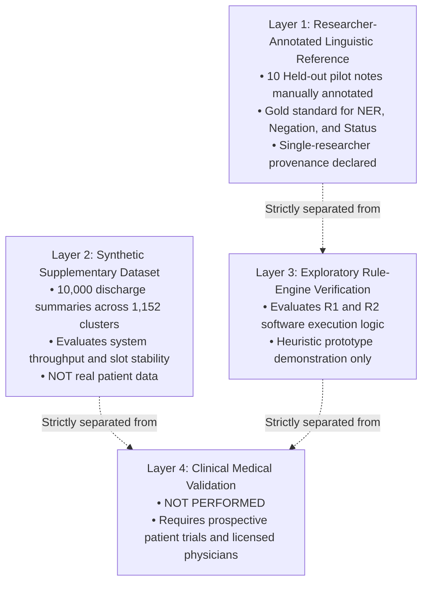

# ClinGap-NLP: Researcher-Led NLP Evaluation Methodology & Protocols

**Document Type:** Formal Evaluation Protocol & Academic Defense Framework  
**Project:** ClinGap-NLP (Clinical Decision Gap Intelligence System)  
**Date:** October 2026  
**Status:** Approved for Single-Researcher Implementation (Academic Integrity Verified)  

---

## 1. Executive Summary & Methodological Framing

In biomedical and academic NLP research, access to practicing clinicians or medical panels for custom dataset annotation is often impossible due to institutional and resource constraints. To achieve an **academically defensible, scientifically honest, and reproducible evaluation**, ClinGap-NLP implements a **Researcher-Led NLP Evaluation Methodology**.

### Core Academic Commitments:
1. **Linguistic Scope:** Evaluation focuses strictly on what an NLP researcher can verify from textual evidence: clinical entity extraction (NER), lexical negation scoping, and explicit investigation status classification.
2. **Explicit Provenance:** All manual annotations are stamped `"verification_status": "RESEARCHER_ANNOTATED"`. The term `"EXPERT_VERIFIED"` is strictly prohibited.
3. **Exploratory Rule-Engine Separation:** Clinical guidelines (`R1`, `R2`) and decision-gap detections are evaluated strictly as **exploratory software logic tests** against predefined software scenarios, with an explicit disclaimer that medical correctness has not been clinically validated.
4. **Zero Fabrication Policy:** Metrics are never calculated on unverified data or using predictions generated by the system itself.
5. **Handling of Ambiguity:** Mentions with ambiguous phrasing can be tagged `is_uncertain: True` and are excluded from standard metric calculations while reported separately in an uncertainty audit.

---

## 2. Four-Layer Categorical Hierarchy

To avoid conflating software behavior with clinical efficacy, the project explicitly distinguishes four levels of artifacts:



---

## 3. Linguistic NLP Evaluation Metrics (Empirical)

All metrics are computed strictly against manually annotated reference cases where `verification_status == "RESEARCHER_ANNOTATED"`.

### 3.1 Clinical Named Entity Recognition (NER)
- Evaluated across 7 entity categories: `DISEASE`, `SYMPTOM`, `MEDICATION`, `INVESTIGATION`, `DOSAGE`, `FREQUENCY`, `LAB_TEST`.
- Evaluates token-level and span-level exact normalized matching:
  $$\text{Precision} = \frac{\text{TP}}{\text{TP} + \text{FP}}, \quad \text{Recall} = \frac{\text{TP}}{\text{TP} + \text{FN}}, \quad \text{F1} = \frac{2 \cdot \text{Precision} \cdot \text{Recall}}{\text{Precision} + \text{Recall}}$$
- Reports both **Micro-F1** (aggregate across all entities) and **Macro-F1** (unweighted mean across entity types).
- Mentions flagged `is_uncertain: True` are excluded from TP/FP/FN and reported in `uncertain_entities_excluded`.

### 3.2 Investigation Extraction (Dedicated Metric)
- Isolates performance on diagnostic tests and laboratory investigations:
  - Measures Precision, Recall, and F1 specifically on `INVESTIGATION` spans.

### 3.3 Negation Detection
- Evaluates clinical assertion classification on matched entity mentions:
  - $\text{True Positives (TP)}$: Mentions correctly recognized as negated.
  - $\text{True Negatives (TN)}$: Mentions correctly recognized as affirmed/present.
  - $\text{False Positives (FP)}$: Affirmed mentions erroneously tagged as negated.
  - $\text{False Negatives (FN)}$: Negated mentions missed by the clausal scoping engine.
  - Reports Accuracy, Precision, Recall, F1, and Specificity ($\frac{\text{TN}}{\text{TN} + \text{FP}}$).

### 3.4 Investigation Status Classification
- Multi-class evaluation across 4 operational diagnostic statuses:
  `completed/performed`, `ordered`, `pending`, `not performed/cancelled`.
- Reports per-class Precision, Recall, F1, and overall classification accuracy.

---

## 4. Exploratory Educational Rule-Engine Testing

Clinical guideline matching and gap detection are evaluated separately under `exploratory_educational_rule_engine`:
- **Rules R1 & R2:** Evaluated for software execution fidelity against predefined test cases.
- **Reporting Requirement:** All outputs include the mandatory academic disclaimer:
  > *"EXPLORATORY SOFTWARE BEHAVIOR: Rules R1 and R2 are educational demonstration heuristics. Rule activation and gap detection results reflect software logic verification only and do NOT denote medical correctness or clinical validity."*

---

## 5. Uncertainty Handling & Inter-Annotator Protocol

1. **Uncertainty Audit:**  
   If an entity boundary, negation scope, or investigation status is borderline, the researcher marks `is_uncertain: True` with an explanation. These annotations are excluded from precision/recall calculations to avoid penalizing or rewarding the system on ambiguous edge cases, and are reported in an `uncertainty_audit` block.
2. **Inter-Annotator Agreement (IAA) Policy:**  
   In compliance with user conditions, **IAA is NOT calculated for single-researcher annotation**. The evaluator explicitly outputs `"inter_annotator_agreement": "NOT_CALCULATED (Single-researcher annotation; no second annotator provided)"`. If a second student or researcher annotates the same 10 cases in the future, the engine automatically calculates Cohen's Kappa and span-overlap F1.

---

## 6. Step-by-Step Annotation & Evaluation Workflow

### Step 1: View a Pilot Note with Line Numbers
```powershell
python evaluation/annotation_tool.py --view 1
```

### Step 2: Add Reference Annotations (Auto-Calculated Offsets)
The helper automatically computes the exact `start_char` and `end_char` from the note text:
```powershell
# Add clinical entities:
python evaluation/annotation_tool.py --add-entity 1 "Palpitations" SYMPTOM
python evaluation/annotation_tool.py --add-entity 1 "dizziness" SYMPTOM
python evaluation/annotation_tool.py --add-entity 1 "Atrial Fibrillation" DISEASE
python evaluation/annotation_tool.py --add-entity 1 "ECG" INVESTIGATION

# Add negation assertions:
python evaluation/annotation_tool.py --add-negation 1 "syncope" TRUE
python evaluation/annotation_tool.py --add-negation 1 "Palpitations" FALSE

# Add investigation clinical statuses:
python evaluation/annotation_tool.py --add-inv 1 "ECG" completed/performed
python evaluation/annotation_tool.py --add-inv 1 "Echo" completed/performed
```

### Step 3: Finalize the Case as Researcher-Annotated
```powershell
python evaluation/annotation_tool.py --finalize 1 --annotator researcher_1
```

### Step 4: Check Progress and Validate Integrity
```powershell
python evaluation/annotation_progress.py evaluation/pilot_10_cases/pilot_10_cases.json
python evaluation/pilot_10_cases/validate_pilot_annotations.py evaluation/pilot_10_cases/pilot_10_cases.json
```

### Step 5: Execute Independent Evaluation
```powershell
python -c "from evaluation.independent_evaluator import run_independent_evaluation_on_batch; import json; res = run_independent_evaluation_on_batch(r'evaluation\pilot_10_cases\pilot_10_cases.json'); print(json.dumps(res, indent=2))"
```
